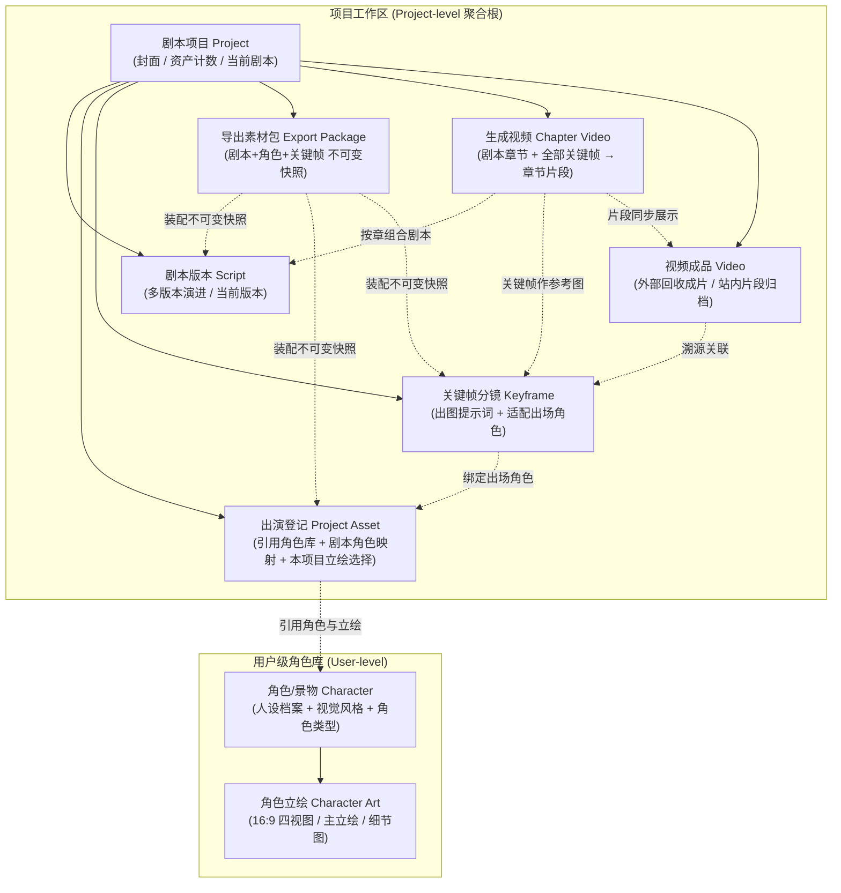
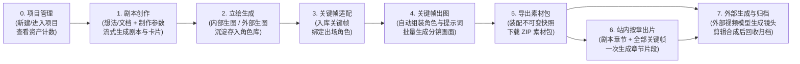
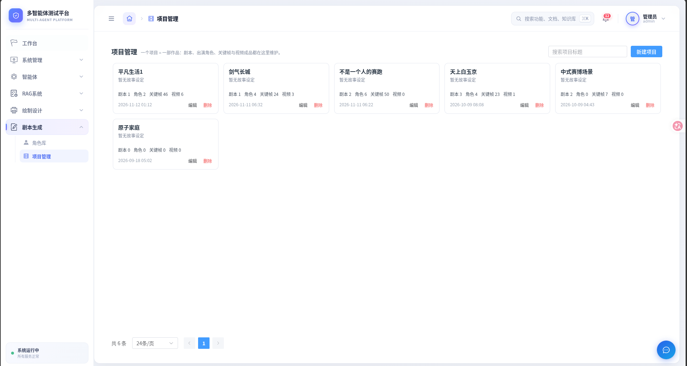
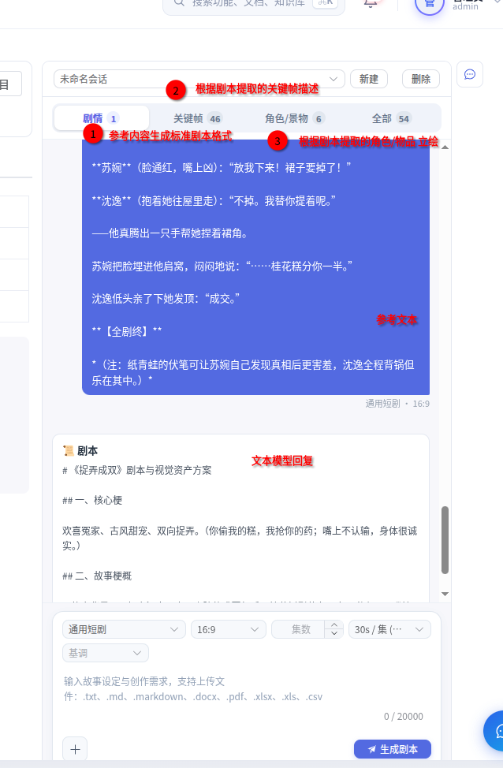
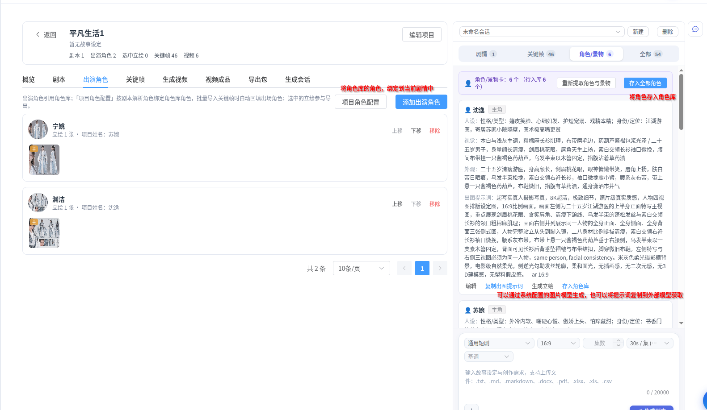
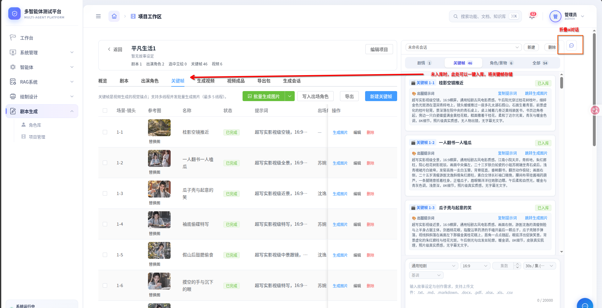
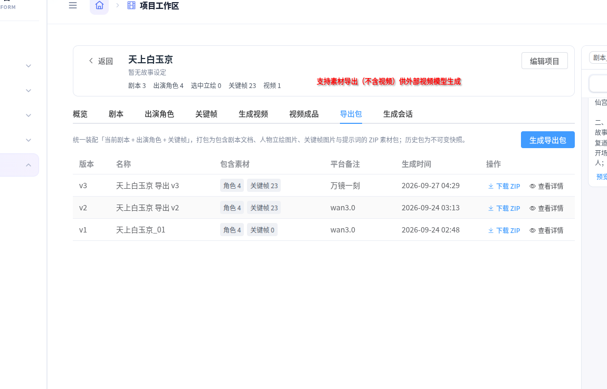
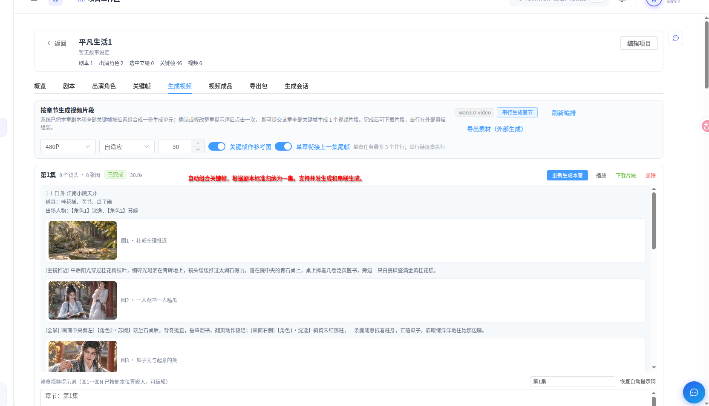
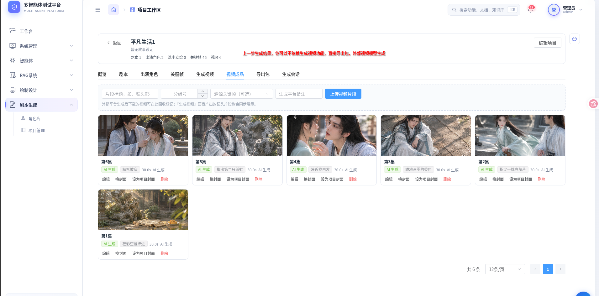

# Story 剧本与漫剧生成系统 - Release

Story 系统是面向短剧、漫剧（动态漫/动画漫剧）、商业广告及 AI 视频创作者的**全流程自动化剧本编排、视觉资产沉淀与分镜工坊**。系统通过大语言模型、多模态生图模型与视频合成模型的协同编排，完成从灵感构思、标准化剧本创作、角色/景物四视图立绘设计、关键帧分镜适配与自动化出图，到站内按章节把剧本与全部关键帧组合后一次生成可播放/下载的章节片段，或一键打包导出统一素材包到外部视频大模型的完整工作闭环，并将站内/外部生成的成片统一回收归档，赋能 Wan3.0、可灵 Kling、Runway、Sora、Seedance、万镜一刻等平台与后期剪辑合成。

---

## 1. 先决条件与环境准备

1. **PostgreSQL 18.0+**
   - Story 模块表结构使用内置 `uuidv7()` 作为主键默认值，要求 PostgreSQL ≥ 18。
   - 执行建表脚本：`database/sql/story_schema.sql`（包含 `story` schema 下项目、角色/景物、立绘、剧本、关键帧、导出包、生成任务与视频成品等全套数据表）；存量库另执行 `database/sql/story_alter_video_generation.sql`（视频生成来源/提示词/参数/失败信息等增量列，幂等）。
2. **AI 模型配置**（前端「模型管理 / 参数管理」页维护，免重启热更新）：
   - **文本生成模型（Chat / Rewrite）**：如 `Qwen4-flash`、`Qwen3.8-flash`、`DeepSeek4.1-flash`、`gpt-6.1-terra` 等，需支持 Tool Calling / Function Call，用于驱动技能文档阅读与双轨结构化剧本输出；
   - **图像生成模型（Image）**：如 `gpt-image2.5`、`gpt-image-2.0` OpenAI 兼容接口，需支持高分辨率出图与参考图输入（图生图/多模态控制），用于角色/景物立绘与关键帧生成；
   - **多模态理解模型（Visual，可选）**：如 `Qwen4-flash`、`Qwen3.8-flash`、`DeepSeek4.1-flash`、`gpt-6.1-terra`，支持用户上传剧情参考图、分镜手稿或人设原案的视觉解析；
   - **视频生成模型（Video）**：站内按章节出片依赖该角色配置——DashScope/MaaS 主机走原生视频合成协议，聚合网关（如 `https://tokenrhythm.studio/v1`）走 `POST {base}/videos/generations` JSON 协议；`extra.resolution` / `extra.ratio` 提供生成面板默认档位，选项由字典 `video_resolution` / `video_ratio` 驱动。
3. **FFmpeg（可选但建议安装）**
   - 用于视频成品首帧封面抽取与「关联集」衔接片段的首尾帧抽取；缺失时封面降级为手动上传，衔接片段降级为仅首帧提交，不阻断主流程。
4. **系统菜单配置**：
   - 确认系统管理内已挂载「剧本生成」菜单组（含「项目管理」与「角色库」，前端对应路由 `story/projects` 与 `story/character`），并为目标角色分配访问权限。

---

## 2. 系统架构与核心资产模型

Story 体系以**项目为聚合根**，以**用户级角色库**为长期跨项目视觉资产基座，核心分工如下：



### 核心资产清单

| 资产对象 | 归属层级 | 核心职责 |
|---|---|---|
| **剧本项目 (`story_projects`)** | 项目聚合根 | 承载单部作品的完整生命周期，记录封面、风格、制作参数、资产计数与任务状态 |
| **角色/景物与立绘 (`story_characters` / `story_character_arts`)** | 用户级跨项目库 | 存储结构化人设/景物档案（性格/身份/视觉特征/专属色）、角色类型（人物/建筑/风景）与高清立绘（16:9 四视图等），跨项目复用 |
| **项目剧本 (`story_scripts`)** | 项目级 | 承载版本化剧本文本，由 `is_current` 单点标记当前活跃版本 |
| **出演登记 (`story_project_assets`)** | 项目级关联 | 引用角色库角色（不拷贝），记录剧本角色名映射、本项目主立绘选择与排序，选中的立绘参与导出 |
| **关键帧分镜 (`story_keyframes`)** | 项目级 | 视频生成的视觉锚点；记录（场景-镜头）编号、出图提示词与最终生成图 |
| **分镜出场角色 (`story_keyframe_characters`)** | 项目级关联 | 记录每个分镜镜头登场的角色、使用的立绘参考图、角色位姿与镜头专属状态描述 |
| **不可变导出包 (`story_export_packages`)** | 项目级快照 | 固化「当前剧本 + 出演角色 + 选中关键帧」生成的统一素材包（ZIP，不含视频），按 `(项目, 导出类型)` 版本递增，支持溯源 |
| **生成视频 / 章节片段 (`story_videos`, `source='generated'`)** | 项目级 | 站内视频模型按章节把当前剧本与全部关键帧组合后生成的一个章节片段；记录整章提示词、参考关键帧、分辨率/画幅/时长等生成参数与 `queued → generating → done / failed / cancelled` 状态，支持重抽、集间首尾帧衔接片段与单片段下载 |
| **视频成品归档 (`story_videos`, `source='upload'`)** | 项目级 | 外部模型生成后回收归档的单镜头片段或长视频成片；记录首帧封面、生成平台备注与关键帧/剧本/导出包溯源；站内生成片段也会同步展示在该面板，整片由用户下载片段后外部组装 |

---

## 3. 核心使用说明（端到端创作工作流）

系统提供从**项目管理、剧本创作、立绘生成、分镜适配、出图渲染、材料导出到按章成片与成品归档**的 7 步标准闭环工作流：



### 工作区总览与项目管理

进入「剧本生成 → 项目管理」，项目以卡片列表呈现，支持按标题搜索与新建项目；每张卡片展示该项目的**剧本数、出演角色数、关键帧数与视频数**，并提供「编辑 / 删除」操作。点击卡片进入项目工作区，顶部为项目信息与资产计数（剧本 / 出演角色 / 选中立绘 / 关键帧 / 视频）。

项目工作区采用 **8 个子视图 Tab**：`概览`、`剧本`、`出演角色`、`关键帧`、`生成视频`、`视频成品`、`导出包`、`生成会话`；右侧为可折叠的 AI 创作抽屉。子视图标识写入 URL query（如 `?tab=keyframe`），支持深链接。



*图 3-1：项目管理列表（项目卡片展示剧本/角色/关键帧/视频计数，支持搜索、新建、编辑与删除）*

---

### 步骤一：输入创作需求，生成标准化剧本与卡片

1. **新建/进入剧本项目**：在「项目管理」中新建或打开已有项目，进入项目工作区。
2. **唤出 AI 创作抽屉**：点击工作区右侧的 AI 故事生成抽屉；支持新建对话会话或切换历史创作会话，右上角按钮可折叠/展开抽屉。
3. **设置制作参数**：
   - **风格预设**：选择视频风格——`通用短剧`、`上美影动画`、`手绘日记`、`纯景意境`，不同风格自动激活对应的专业编剧技能与分镜提示词配方（纯景意境为无剧情/无人物风光漫游，Tab 相应变为「分镜 / 景物立绘」）；
   - **画幅比例**：按风格提供 `16:9` 横屏电影感、`9:16` 竖屏短剧、`4:3` 传统画幅或 `3:4` 竖版等选项（推荐默认 `16:9`）；
   - **集数与单集时长**：设定集数与单集预估秒数（**建议单集控制在 15s 或 30s**，严格匹配 AI 视频大模型分镜时长与运镜节奏）；
   - **基调与风格词**：可填入基调（如 `空灵`、`冷峻`、`悬疑`、`热血` 等）。
4. **输入故事构思 / 上传参考文档**：
   - 在底部输入框中粘贴您的大致剧情大纲、小说段落、对话灵感（输入框上限 20000 字）；
   - 支持点击「+」上传或拖拽文件（支持 `.txt`、`.md`、`.markdown`、`.docx`、`.pdf`、`.xlsx`、`.csv` 等），系统会自动解析文档内容注入上下文；也可上传参考图片供视觉模型分析。
5. **流式生成剧本与产物卡片**：
   - 点击「生成剧本」，大模型将基于专业技能规则进行流式构思输出；
   - 生成完毕后，系统采用**双轨解析机制**，自动生成并呈现三大产物卡片：
     - **📜 标准化剧本卡片**：包含核心梗、故事梗概、一句话卖点、人物小传（带稳定角色编号预留）、剧本大纲与正文（严格以 `【关键帧 场次-镜头】` 锚定每个镜头，预估分镜时长 15s 或 30s）；
     - **👤 角色/景物立绘卡片**：自动提取人设、视觉特征、专属主色与角色类型，并生成包含 **16:9 四视图黄金排版**（半身大头正面特写 + 全身正面/侧面/背面三视图）的专业出图提示词；景物/建筑/道具则生成多视角设定图提示词；
     - **🎬 关键帧分镜卡片**：自动拆解出剧本的全部关键帧，附带景别运镜、画面视觉、光影氛围、预估时长及专业出图提示词。
6. **抽屉分区与批量沉淀**：抽屉顶部按 `剧情 / 关键帧 / 角色·景物 / 全部` 分类展示产物；「关键帧」区在存在未入库镜头时显示「待入库关键帧」快捷横幅与「存入全部关键帧」；「角色·景物」区提供「重新提取角色与景物」与「存入全部角色」，可从剧本正文重新抽取角色/景物卡并批量入库。



*图 3-2：AI 创作抽屉（参考文本 + 制作参数 + 流式生成的剧本/关键帧/角色卡片，按剧情与资产分区管理）*

---

### 步骤二：立绘生成、出演登记与角色沉淀入库

针对 AI 输出的角色/景物立绘卡片，系统提供**双通道出图**、**项目出演登记**与**资产一键沉淀**支持：

1. **双通道生图方式**：
   - **通道 A（直接内部生成立绘）**：在角色卡片上点击「生成立绘」按钮，可按需微调尺寸（默认横版 `1536x1024` / `16:9`）与画质档位，系统将自动发起生图任务并轮询，生成完成后直接在会话中预览；
   - **通道 B（外部图像大模型生成）**：点击「复制出图提示词」，复制系统生成的 16:9 四视图结构化提示词（已内置主体特征、排版结构、同人一致性约束及真实质感负向词），前往 OpenAI 的 gpt-image2.0、gpt-image2.5 或外部生图网站出图，下载满意的立绘图片后回传。
2. **出演角色面板（项目级）**：
   - 切换到「出演角色」Tab，面板引用用户级角色库，展示本项目已登记角色的立绘数与剧本项目姓名，支持「上移 / 下移」排序与「移除」；
   - **项目角色配置**：按剧本解析出的角色名，逐一绑定角色库角色；批量导入关键帧时系统据此自动回填出场角色；
   - **添加出演角色**：从角色库选入角色到本项目；卡片上的「编辑 / 复制出图提示词 / 生成立绘 / 存入角色库」与 AI 抽屉保持一致；
   - **选中立绘参与导出**：为每个角色选定本项目使用的主立绘，导出包与关键帧参考图均以选中立绘为准。
3. **角色卡编辑与沉淀入库**：
   - **编辑人设**：点击卡片上的「编辑」按钮，可在入库前自由微调角色的性格、外貌特征与出图提示词；
   - **存入角色库**：点击「存入角色库」，系统支持：
     - **新建角色**：将该角色沉淀到当前用户的独立角色库中，供跨项目长期复用；
     - **合并到已有角色**：若库内已存在同名角色，可选择合并收编新立绘；
     - **自动出演登记**：角色入库的同时，系统会自动将该角色登记入当前项目的「出演角色」列表中。
4. **剧本版本沉淀**：
   - 在剧本卡片上点击「存为版本」，输入版本标题并勾选「设为当前版本」，将生成的剧本文本固化为项目的正式剧本（如 `v1`、`v2`）；「剧本」Tab 中可随时切换当前版本。



*图 3-3：出演角色面板（项目角色配置、添加/排序/移除出演角色，以及角色入库与立绘生成立入口）*

---

### 步骤三：进入关键帧管理列表，为关键帧适配角色

1. **切换到「关键帧」面板**：
   - 点击项目工作区的「关键帧」Tab；关键帧是视频生成的视觉锚点；
   - 可在 AI 抽屉中点击「存入关键帧」（或在卡片上点击「跳转生成图片」），系统会自动将 AI 分镜保存至项目的正式关键帧库中；抽屉横幅支持「一键存入全部关键帧」，已入库的关键帧卡片会显示「已入库」标记。
2. **浏览关键帧列表**：
   - 关键帧列表按 `场景号-镜头号`（如 `1-1`、`1-2`、`1-3`）严格排序；
   - 每行清晰展示：镜头编号、参考缩略图、镜头名称、状态（草稿 / 生成中 / 已完成 / 失败）、正向提示词摘要、已绑定的出场角色以及操作项；
   - 顶部工具栏提供「批量生成图片」「写入出场角色」「导出」「新建关键帧」与「中断全部生成」，支持勾选多行做批量生图或批量删除。
3. **出场角色适配（核心步骤）**：
   - 点击对应关键帧操作列的 **「出场角色」** 按钮；
   - 弹窗将列出本项目在「出演角色」中登记的全部角色：
     - **勾选登场角色**：勾选该镜头中出现的人物（如 `云疏`、`陈平安` 等）；
     - **选择参考立绘**：为该角色选择最适合该镜头的立绘参考图（默认使用 16:9 四视图或主立绘）；
     - **指定角色级别**：设置主角（`main`）、配角（`secondary`）或背景人物（`background`）；
     - **补充镜头专属状态**：在「镜头状态」输入框中可针对本分镜补充角色动作与表情（如 `长廊中缓步前行，背影微侧`、`拔剑出鞘，眼神凌厉`）。
   - 点击保存，完成该关键帧的角色空间绑定与状态配置。
4. **批量自动写入出场角色**：
   - 点击「写入出场角色」，系统扫描本项目全部关键帧，为尚未绑定角色且能按剧本角色名匹配到角色的镜头自动写入出场角色；已手工绑定的关键帧不会被改动；景物/建筑类资产不参与人物出场自动绑定。
5. **出图提示词维护**：点击操作列「编辑」可修改镜头名称、章节/场景/镜头编号与出图提示词；编号冲突由后端校验，提示词是后续自动出图的唯一画面描述来源。



*图 3-4：关键帧管理列表（镜头编号/状态/提示词/出场角色一屏总览，支持批量生图、写入出场角色与未入库关键帧一键沉淀）*

---

### 步骤四：点击生成图片，自动化组装并提交生图

1. **发起关键帧生图**：
   - 在关键帧列表对应行中，点击 **「生成图片」** 操作按钮；
   - 或勾选多行后点击顶部 **「批量生成图片」**，系统按多线程工作池并发提交（**单项目最多 5 个关键帧生图任务并行**），进度条实时展示完成/失败数量；
   - 若尚未设置出场角色，系统会弹出智能提示：建议先绑定角色立绘以保证一致性，亦可针对空镜头或纯场景继续直接生成。
2. **全自动组装机制（保证角色与画面一致性）**：
   - 后端 `KeyframeService` 自动执行以下提示词与视觉资产装配：
     - **正向画面提示词**：读取关键帧 `prompt`（景别运镜、画面主体、环境光影与风格质感）；
     - **角色特征与局部状态**：根据绑定的出场角色，自动追加注入角色外观描述与镜头状态（格式：`出场角色：角色名（设定：外观描述；镜头状态：该镜头具体动作表情）`）；
     - **参考图多模态控制**：自动提取已绑定角色的高清立绘图片文件，作为图像大模型的形象基准输入；
3. **后台异步渲染与轮询**：
   - 系统将任务提交给底层配置的图像大模型；
   - 状态实时流转为「生成中」，前台自动启动平滑状态轮询；支持单行「中断生成」或顶部「中断全部生成」，即时释放项目任务并发槽位；
   - 生图完成后，状态自动切换为「已完成」，列表即刻呈现高清分镜画面，并支持点击放大预览或手动替换本地修改图；失败行可直接「重新生成」。

---

### 步骤五：导出材料包，获取完备的项目资产快照

分镜画面准备齐全后，进入素材包导出流程：

1. **导出选择（可选）**：
   - 在关键帧面板点击「导出」，可按需要挑选特定分镜参与导出并调整导出顺序；若未特别挑选，默认导出项目下全部有效关键帧。
2. **生成导出包**：
   - 切换到 **「导出包」** Tab，点击 **「生成导出包」** 按钮；
   - 填写导出包名称与目标平台备注（如 `wan3.0`、`万镜一刻`、`kling`、`runway` 等），点击确定。
3. **统一不可变快照装配**：
   - 系统自动装配「当前剧本 + 出演角色（含选中立绘）+ 选中关键帧」，按 `(项目, 导出类型)` 生成版本递增（`v1`、`v2`、`v3`…）的不可变快照记录；后续剧本或关键帧的修改均不会影响已归档的历史导出包；
   - 列表展示版本、名称、包含素材（角色数 / 关键帧数）、平台备注与生成时间，支持「查看详情」在线预览快照内容。
4. **下载与解压 ZIP 素材包**：
   - 点击列表中的 **「下载 ZIP」**，浏览器将直接启动原生流式下载；
   - 导出包**只包含生成视频所需的原始素材（剧本、角色立绘、关键帧图文），不包含视频文件**，供外部视频大模型生成使用。



*图 3-5：导出包面板（不可变版本归档、角色/关键帧素材计数、平台备注与一键下载 ZIP；素材不含视频）*

#### 统一素材包解压目录规范

下载的 ZIP 压缩包已针对视频大模型与后期制作进行了标准化工程归档：

```text
《天上白玉京》视频生成素材包_v2.zip
├── 剧本/
│   ├── 剧本.md                          # 完整排版的 Markdown 格式剧本
│   └── 剧本.txt                         # 适合直接复制的纯文本剧本
├── 人物立绘/
│   ├── 角色总览.txt                      # 本剧出演角色名单、人设与视觉总览
│   ├── 01_云疏/
│   │   ├── 角色信息.txt                  # 云疏的独立人设、服饰风格、外观描述
│   │   └── 01_主视图+三视图_主立绘.png    # 16:9 高清四视图立绘图片
│   └── 02_陈平安/
│       ├── 角色信息.txt                  # 陈平安的独立人设与描述
│       └── 01_主视图+三视图_主立绘.png    # 高清立绘原图
├── 关键帧/
│   ├── 关键帧总览.txt                    # 全部镜头的场景号、镜头号与运镜汇总
│   ├── 01_场景1-镜头1_白玉京悬空全貌_提示词.txt  # 该镜头的独立提示词、运镜与出场角色说明
│   ├── 01_场景1-镜头1_白玉京悬空全貌.png        # 自动化生成的关键帧高清画面图片
│   ├── 02_场景1-镜头2_五城十二楼升降_提示词.txt
│   ├── 02_场景1-镜头2_五城十二楼升降.png
│   └── ...                              # 更多分镜图文素材按镜头序号排列
├── 完整提示词与说明.txt                   # 全片一键复制总览文档（含剧本、角色与所有镜头）
└── manifest.json                        # 机器友好的结构化快照元数据（JSON 格式）
```

---

### 步骤六：按章节编排并生成可播放/下载的视频片段（可选）

1. 进入项目 **「生成视频」** Tab，系统读取当前剧本，把每个 `第N集` 章节正文中的
   `【关键帧 场次-镜头】` 标记替换为对应关键帧图片，自动组合成「剧本 + 图1…图N」的整章生成单元；
   剧本或关键帧调整后，可点击 **「刷新编排」** 重新解析并重排章节；
2. 逐章查看内嵌关键帧的章节剧本，点击「编辑提示词」按需修改整章提示词与片段标题（默认收起）；修改后可「恢复自动提示词」回到系统编排结果；
3. 选择分辨率（`480P` / `720P` / `1080P`）、画幅（`自适应` / `16:9` / `9:16` / `1:1` / `4:3` / `3:4`）与片段时长（2~30s，建议与单集时长一致），保持「关键帧作参考图」开启：关键帧会先缩边并重编码为轻量 JPEG 再内联提交（避免多图 base64 撑爆请求体）。DashScope 原生接口不允许参考图与首帧/尾帧同时下发，系统按图片形态拆分提交；上游拒绝入参（400/413/422 或任务阶段 `InvalidParameter`）时逐级降级，已提供关键帧时不会静默回退纯文生，鉴权/端点错误会直接暴露；
4. 点击章节 **「生成本章片段」**（已生成过的章节显示「重新生成本章」）：该章全部关键帧一次性提交，生成 **1 个** 章节视频片段；或点击顶部 **「批量生成未完成章节」**，把全部尚未出片且已有关键帧的章节一次性并发提交（各集独立生成、互不等待）；
5. 各章任务按项目并发上限排队（**最多 3 个并行**）；面板实时轮询章节状态，完成后可 **播放 / 下载片段 / 删除**；
6. 进入 **「关联集」** Tab：相邻两集都完成后，可为该衔接位生成 **集间衔接片段**——系统抽取上一集成片尾帧作首帧、下一集成片首帧作尾帧，生成一段过渡视频，插入两集之间完成跨集衔接；当前模型不支持尾帧时降级为仅首帧提交（保证从上一集结尾起幅）。衔接片段同样支持播放 / 下载 / 删除与中止；同一衔接位「重新生成」会替换旧衔接片段，若某集片段重做过，衔接位会提示「基于旧片段」；
7. 需要走外部生成时，点击顶部 **「导出素材（外部生成）」** 可直接跳转导出包面板，按步骤五打包素材；
8. 下载各章节片段（及需要的衔接片段）后，自行在剪映、Premiere 等剪辑软件中组装整片。



*图 3-6：按章生成视频面板（章节自动编排、关键帧内嵌预览、分辨率/画幅/时长、单章与批量生成）*

> 素材包导出（步骤五）与外部平台手动生成路径不受影响，站内按章出片与外部生成可并行使用。

---

### 步骤七：自行在外部视频模型生成，并编辑合成、回收归档

1. **外部视频大模型生成单镜头片段**：
   - 打开解压后的素材包，进入 `关键帧/` 目录；
   - 登录外部视频生成平台（如 **Wan 3.0**、**可灵 AI Kling**、**海螺 h3（minimax h3）**、**万镜一刻**、**即梦 Jimeng**等）；
   - **图生视频工作流**：将每个镜头的关键帧高清图片（如 `01_场景1-镜头1_白玉京悬空全貌.png`）上传为起始帧或参考底图；
   - **运镜与动态提示词**：打开对应的 `_提示词.txt`，复制其中的镜头运镜描述与场景动作提示词，输入视频平台生图框；
   - 结合剧本标注的单镜头预估秒数（如 2~5 秒），渲染产出对应的动态视频切片。
2. **后期长视频剪辑与音效合成**：
   - 打开剪辑软件（如 **剪映 / CapCut**、**Adobe Premiere Pro**、**必剪** 等）；
   - **素材导入与音画对齐**：
     - 参考 `剧本/剧本.md`，将生成的各镜头视频片段按场景与镜头顺序拖入时间线；
     - 使用 TTS 语音合成或专业配音录制台词与旁白音频；
     - 根据正文中的情绪节奏与镜头秒数剪辑画面，添加转场、音效（SFX）与背景音乐（BGM）；
   - 导出为完整的高清长视频成片（如 MP4 / MOV）。
3. **视频成品回收与溯源归档**：
   - 进入项目的 **「视频成品」** Tab；站内「生成视频」产出的章节片段会自动同步展示（带「AI 生成」标记），外部成片通过顶部表单上传登记；
   - **上传字段**：`片段标题`（如「镜头03」）、`分组号`（章节/分组排序）、`溯源关键帧`（可选，关联来源镜头）、`生成平台备注`（如 wan3.0 / kling）、`上传视频片段`（mp4/mov/webm/mkv，受视频上传大小上限约束）；
   - 系统自动提取视频首帧作为封面（ffmpeg 缺失时降级为手动封面），并可按列表分页浏览；卡片支持「编辑 / 换封面 / 设为项目封面 / 删除」，形成完整的创作成品沉淀。



*图 3-7：视频成品面板（外部片段上传登记、AI 生成片段同步展示、封面与项目封面管理、按分组归档）*

---

## 4. 关键设计规范与技术特色

### 4.1 双轨输出契约（Dual-Track Output Contract）

为解决大语言模型自由文本创作与系统结构化落库之间的冲突，Story 采用自定义围栏双轨契约：
- **第一轨（剧本全文）**：模型严格按六段式结构（核心梗、梗概、卖点、人物小传、大纲、剧本正文）输出可读文本；
- **第二轨（结构化资产数据块）**：文本末尾使用独占标记 `<<<STORY_CARDS>>>` 与 `<<<END_STORY_CARDS>>>` 包裹包含 `characters`（角色/景物卡）与 `keyframes`（关键帧清单）的 JSON 数据；
- **服务端剥离与安全落库**：后端在流式生成完成时，单点切分正文与 JSON 块，剧本正文落库为剧本消息，角色卡与关键帧作为子卡片即时展示并支持独立交互沉淀；解析宽容降级为仅剧本，不阻断生成。

### 4.2 16:9 人物四视图黄金立绘规范

系统内置《人物特写与三视图立绘设计规范》与《景物与场景建筑立绘设计规范》，角色立绘默认强制要求 **16:9 比例画面** 与 **四视图黄金排版**：
- **排版结构**：
  - **左侧**：单人半身大头正面特写作为主视图（重点展现五官神态、发饰、妆容细节与服饰领口）；
  - **右侧**：横向并列展示该角色的 **全身正面**、**全身侧面**、**全身背面** 三视图（从头到脚完整站立，真实人体比例）。
- **同人一致性法则**：提示词中明确锁定 `Same identity, facial consistency`，保证发型、服饰款式、色彩纹样与材质在四个视图中完全一致；
- **真实质感防偏**：采用【画面类型 + 排版结构 + 人物本体 + 造型细节 + 材质描述 + 光影背景 + 风格限制】模块化编写，加入电影级柔光棚背景与质感词，避免脸谱化与机械堆砌；
- **景物/建筑独立规范**：角色类型为 `building` / `scenery` / `landscape` 时，改为多视角建筑/景物/道具设定图排版与材质细节规则，且不参与人物出场自动绑定。

### 4.3 关键帧提示词与画面描述

每个分镜关键帧的 `prompt` 即唯一画面描述与出图提示词，严格遵循电影视听镜头语言规范：
- **单集生成时长硬规则**：单集总时长严格控制在 **≤15s 或 ≤30s**（适配当前 AI 视频模型生成上限）；
- **人物编号与画面空间位置标记**：出场人物标明稳定编号（如 `【角色1·林冲】`），镜头描述中必须明确人物在画面中的出现空间（如 `[画面中央]`、`[前景左侧]`、`[背景右侧]`），确保空间调度清晰；
- **提示词内容结构**：写清景别与运镜（远景/全景/中景/特写，推/拉/摇/移）、画面主体与构图、环境细节、光影色调与氛围、艺术媒介与画质质感，可直接用于图片大模型出图。

### 4.4 风格注册表与技能渐进式阅读

风格由 `agent/skills/loader.py::STYLE_REGISTRY` 统一注册，前端生成表单的选项与画幅预设均来自该注册表：

| 风格 Key | 名称 | 特点 | 支持画幅 |
|---|---|---|---|
| `generic` | 通用短剧 | Seedance 分镜工作流，写实/动画/水墨/科幻开放 | 16:9 / 9:16 / 4:3 |
| `shangmeiying` | 上美影动画 | 复古手绘、水墨线条、矿物颜料平涂，国风短剧专用 | 16:9 / 9:16 / 4:3 |
| `handdrawn` | 手绘日记 | 白底 + 记号笔轮廓 + 水彩蜡笔色，一句一拍叙事 | 16:9 / 9:16 / 3:4 |
| `scenery` | 纯景意境 | 无剧情/无人物风光漫游，空镜光影与场景变换分镜 | 16:9 / 9:16 / 4:3 |

- **生成前必读技能**：模型必须先调用 `skill_read` 读取风格对应的 `SKILL.md`，再按需阅读 `references/*.md|txt`（立绘规范、分镜优化、平台手册等）；读取路径与后缀受白名单约束，只读、不可执行；
- **风格即配方**：不同风格绑定不同的可读文件清单与分镜配方，保证剧本格式、立绘规范与关键帧提示词在同一风格下长期一致。

---

## 5. API 路由速查

所有路由均挂载于 `ENV.base_url` 下的 `/story` 前缀，响应统一为 `{code, msg, data}`。

| 模块分类 | 请求方式 | 接口路径 | 功能描述 |
|---|---|---|---|
| **项目管理** | `GET` | `/story/projects` | 分页查询项目（按标题搜索，返回剧本/角色/关键帧/视频计数） |
| | `POST` | `/story/projects` | 新建剧本项目 |
| | `GET` / `PUT` / `DELETE` | `/story/projects/{project_id}` | 查看 / 编辑 / 删除项目 |
| **剧本版本** | `GET` / `POST` | `/story/projects/{project_id}/scripts` | 查询版本列表 / 新建剧本版本 |
| | `PUT` | `/story/scripts/{script_id}` | 编辑剧本内容 |
| | `PUT` | `/story/scripts/{script_id}/current` | 切换当前活跃剧本版本 |
| **生成会话** | `POST` / `GET` | `/story/projects/{project_id}/sessions` | 新建会话 / 查询项目会话列表 |
| | `GET` | `/story/projects/{project_id}/sessions/latest` | 获取项目最近会话 |
| | `GET` / `DELETE` | `/story/sessions/{session_id}` | 会话详情 / 删除会话 |
| | `GET` | `/story/sessions/{session_id}/messages` | 会话消息与产物卡片列表 |
| | `GET` | `/story/projects/{project_id}/generation-tasks` | 项目生成任务列表 |
| | `GET` | `/story/generation-tasks/{task_id}` | 生成任务详情与状态 |
| **剧本生成** | `GET` | `/story/styles` | 获取风格注册表枚举与画幅预设 |
| | `POST` | `/story/upload-image` | 上传多模态对话或生图参考图片 |
| | `POST` | `/story/sessions/{session_id}/generate` | 发起流式剧本生成（SSE，think/answer/done 事件） |
| | `POST` | `/story/sessions/{session_id}/stop` | 停止在途剧本生成任务 |
| **资产沉淀** | `PUT` | `/story/messages/{message_id}/card` | 编辑角色/关键帧卡片内容 |
| | `POST` | `/story/messages/{message_id}/save-script` | 剧本卡存为项目剧本新版本（可选设为当前版本） |
| | `POST` | `/story/messages/{message_id}/save-character` | 角色卡存入角色库（支持新建或并入，自动登记出演） |
| | `POST` | `/story/messages/{message_id}/save-art` | 将外部立绘图片存入角色卡 |
| | `POST` | `/story/messages/{message_id}/generate-art` | 从角色卡直接发起内部人物立绘生成任务 |
| | `POST` | `/story/messages/{message_id}/save-keyframe` | 将会话关键帧卡存入项目关键帧库 |
| | `POST` | `/story/sessions/{session_id}/save-keyframes` | 一键将当前会话中的全部关键帧存入关键帧库 |
| | `POST` | `/story/sessions/{session_id}/extract-characters` | 从剧本正文重新提取角色/景物卡 |
| | `POST` | `/story/sessions/{session_id}/save-characters` | 一键将当前会话中的全部角色存入角色库 |
| **角色库** | `GET` / `POST` | `/story/characters` | 分页查询 / 新建角色 |
| | `GET` / `PUT` / `DELETE` | `/story/characters/{character_id}` | 角色详情 / 编辑 / 删除 |
| | `POST` | `/story/characters/{character_id}/arts` | 为角色新增立绘 |
| | `PUT` | `/story/characters/{character_id}/arts/{art_id}/primary` | 设为主立绘 |
| | `DELETE` | `/story/characters/{character_id}/arts/{art_id}` | 删除立绘 |
| **出演角色** | `GET` / `POST` | `/story/projects/{project_id}/characters` | 查询出演角色 / 从角色库添加出演 |
| | `GET` | `/story/projects/{project_id}/characters/script-roles` | 获取剧本解析角色（用于项目角色配置） |
| | `DELETE` | `/story/projects/{project_id}/characters/{character_id}` | 移除出演角色 |
| | `PUT` | `/story/projects/{project_id}/characters/sort` | 调整出演顺序 |
| | `PUT` | `/story/projects/{project_id}/characters/script-names` | 保存「剧本角色 → 角色库角色」映射 |
| | `PUT` | `/story/projects/{project_id}/art-selection` | 保存本项目选中的角色立绘（参与导出） |
| **关键帧管理** | `GET` / `POST` | `/story/projects/{project_id}/keyframes` | 分页查询（按镜头编号升序）/ 新建关键帧 |
| | `POST` | `/story/projects/{project_id}/keyframes/batch-delete` | 批量删除关键帧 |
| | `POST` | `/story/projects/{project_id}/keyframes/auto-bind-characters` | 扫描未绑定关键帧并自动写入出场角色 |
| | `POST` | `/story/projects/{project_id}/keyframes/stop-all` | 中断项目下全部关键帧生图任务 |
| | `PUT` | `/story/projects/{project_id}/keyframe-selection` | 保存导出选择与顺序 |
| | `GET` / `PUT` / `DELETE` | `/story/keyframes/{keyframe_id}` | 关键帧详情 / 编辑 / 删除 |
| | `PUT` | `/story/keyframes/{keyframe_id}/characters` | 为关键帧配置出场角色（绑定立绘与镜头状态） |
| | `POST` | `/story/keyframes/{keyframe_id}/generate-image` | 自动组装角色与提示词，发起关键帧生图 |
| | `POST` | `/story/keyframes/{keyframe_id}/stop` | 中断在途的关键帧图片生成任务 |
| | `POST` | `/story/keyframes/{keyframe_id}/image` | 手动上传或替换关键帧参考图片 |
| **导出包** | `POST` / `GET` | `/story/projects/{project_id}/exports` | 装配「剧本+角色+关键帧」不可变快照 / 查询快照历史 |
| | `GET` | `/story/exports/{package_id}` | 导出包快照详情（在线预览） |
| | `GET` | `/story/exports/{package_id}/download` | 下载统一素材包 ZIP 归档文件 |
| **视频生成** | `GET` | `/story/projects/{project_id}/video-plan` | 读取当前剧本，按章节把全部关键帧嵌入剧本位置并合成整章提示词 |
| | `POST` | `/story/projects/{project_id}/videos/generate` | 生成一个章节片段（一次提交整章提示词与全部关键帧参考图） |
| | `POST` | `/story/projects/{project_id}/video-links` | 生成集间衔接片段（上一集成片尾帧作首帧、下一集成片首帧作尾帧） |
| | `GET` | `/story/projects/{project_id}/video-links` | 关联集视图：每集最新已完成片段 + 全部衔接片段 |
| | `GET` | `/story/videos/generation-options` | 生成面板公共配置（分辨率/画幅档位、项目并发上限） |
| | `POST` | `/story/videos/{video_id}/stop` | 中止在途视频生成任务（链内章节会中止整链） |
| | `POST` | `/story/projects/{project_id}/videos/stop-all` | 中止项目下全部在途视频任务 |
| | `GET` | `/story/videos/{video_id}/download` | 下载章节视频片段（附件流） |
| **视频成品** | `POST` / `GET` | `/story/projects/{project_id}/videos` | 上传登记外部视频成品 / 分页查询视频列表（可按来源/状态过滤） |
| | `PUT` / `DELETE` | `/story/videos/{video_id}` | 编辑视频元数据 / 删除视频 |
| | `POST` | `/story/videos/{video_id}/cover` | 手动上传或更换视频封面 |
| | `POST` | `/story/videos/{video_id}/project-cover` | 将视频封面设为项目封面 |
